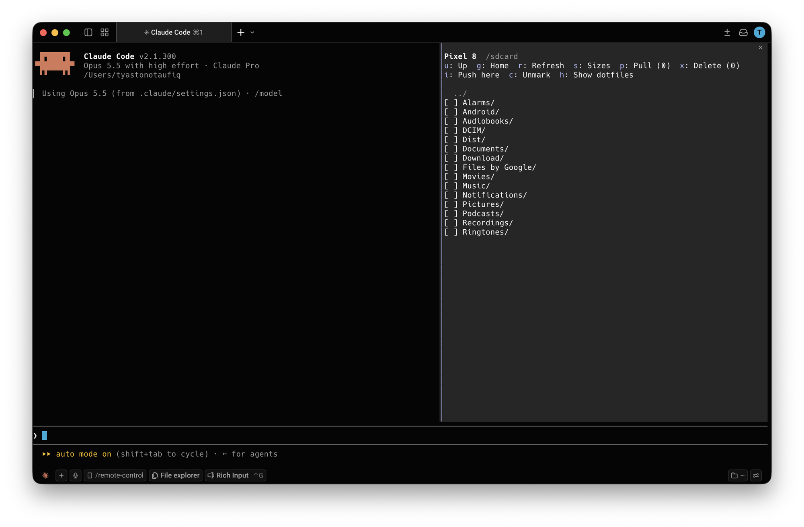

# ADB Explorer

A Claude Code plugin for browsing and managing files on an Android device over `adb`, without leaving Claude Code.

- **`/adb-explorer`** opens a pane: browse folders, see sizes, mark files, pull them to your Mac, push files and folders to the phone (drag them in from Finder), and delete with confirmation.
- **The `android-files` skill** lets you ask Claude in plain language: "how much space do my WhatsApp videos take?", "copy this year's screenshots to my Mac", "move the marked files to the trash".



## Requirements

- Claude Code v2.1.287 or later, in the terminal or the Code tab of the Claude Desktop app
- `adb`. If you have Android Studio, you already have it: the pane finds it in `$ANDROID_HOME`, `$ANDROID_SDK_ROOT` or `~/Library/Android/sdk`, and uses it before any other copy so it doesn't fight Android Studio's adb server. Without Android Studio: `brew install android-platform-tools`.
- On the phone: Developer options › **USB debugging** on, then tap **Allow** when the phone asks

## Install

In a Claude Code terminal session:

```
/plugin install adb-explorer --marketplace tyastonotaufiq/claude-mods
```

Answer `y` to add the marketplace, then pick a scope. In the Desktop app: **+ › Plugins › Add marketplace** with `tyastonotaufiq/claude-mods`, then **Add plugin**.

### From a folder

Load it for one session:

```bash
claude --plugin-dir ~/claude-mods/adb-explorer
```

To load it in every session, add the folder to `~/.claude/settings.json`:

```json
{
  "env": {
    "CLAUDE_CODE_PLUGIN_DIRS": "/Users/<you>/claude-mods/adb-explorer"
  }
}
```

Check it loaded: run `/plugin` and look for `1 mod active · adb-explorer`.

## Claude Desktop

1. Install the plugin: click **+** next to the prompt box, then **Plugins › Add marketplace** with `tyastonotaufiq/claude-mods`, then **Add plugin** and pick **adb-explorer**. A plugin installed from a terminal at the user scope, or listed in `CLAUDE_CODE_PLUGIN_DIRS`, loads here too.
2. Open the **Code** tab and start a session. Mods only run in the Code tab, not in regular chats.
3. Type `/adb-explorer` in the prompt box. The pane opens beside the conversation; click its buttons or use the keys below.

The Desktop app may not have your shell's `PATH`, so the pane looks for `adb` directly: the Android SDK's `platform-tools` first, then `PATH`, `/opt/homebrew/bin` and `/usr/local/bin`. The `android-files` skill works in the same session: ask Claude about your phone's files while the pane is open.

## The pane

Run `/adb-explorer`, or `/adb-explorer /sdcard/DCIM` to start in a folder.

The header shows the device's name, then its Android version, free space in user storage, and battery, for example `Android 16 (API 36) · 3.1 GB free of 9.7 GB · Battery 100%`. It updates on refresh and after a push or delete.

| Key | Action |
| --- | --- |
| Up / Down, Enter | Move between rows, open a folder |
| Enter on `[ ]` | Mark or unmark a row (Enter on a file name also marks it) |
| `u` | Up one folder |
| `g` | Go to `/sdcard` |
| `r` | Refresh devices and folder |
| `s` | Measure folder sizes in this folder |
| `p` | Pull marked items to `~/Downloads/adb-explorer/<model>/` |
| `o` | Open the pulled folder in Finder |
| `i` | Push files or folders from your Mac into this folder: drag them from Finder onto the field, or type a path |
| `x` | Delete marked items (asks first) |
| `c` | Unmark everything |
| `h` | Show or hide dotfiles |
| Esc | Close the pane |

With more than one device connected, a dropdown picks the device. The pane remembers the last folder per device.

## Safety

- Deletes only work strictly inside `/sdcard` (and `/storage/emulated/0`). Anything else is refused before you're asked.
- Every delete asks first. The default, **Move to device trash**, moves files to `/sdcard/_adb_trash/<timestamp>/`, so you can restore them. **Delete permanently** uses `rm -rf`.
- Every adb call passes `-s <serial>`, so it can't act on the wrong device, and runs as an argument list, never through a local shell.
- The skill tells Claude the same rules: show what will be deleted, wait for your yes, trash by default.

Mods run with your permissions and aren't sandboxed. Read `hooks/register.tsx` before installing; it's short.

## Files

```
adb-explorer/
├── .claude-plugin/plugin.json
├── hooks/
│   ├── hooks.json
│   ├── register.tsx      the pane, /adb-explorer, and the state tool for Claude
│   └── adb.ts            parsing, quoting and the delete rules (no I/O)
├── skills/android-files/SKILL.md
├── docs/screenshot.png
├── types/index.d.ts
└── tests/                run with: claude plugin test .
```

## Known limits

- `/sdcard/Android/data` and `/sdcard/Android/obb` are blocked for adb on Android 11 and later.
- No thumbnails: the pane is text. Pull a file and press `o` to view it.
- The VS Code extension's chat panel and `claude -p` don't draw panes; the skill still works there.
