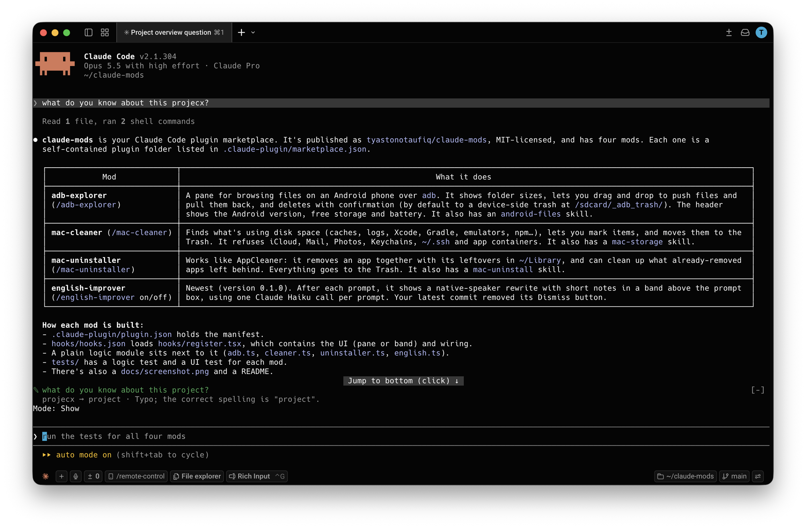

# English Improver

A Claude Code plugin for people who write to Claude in English as a second language. After each prompt you send, it shows how a native speaker would write the same thing, with a short note on each change, in a band above the prompt box. You learn while you work. By default your prompt is never changed or delayed; you can also have Claude get the improved version instead, or pick each time.



```
> when i click rescan inside app, it's show lefover

  ✎ When I click rescan inside the app, it shows leftovers.
    it's show → it shows · Subject-verb agreement; "it's" isn't needed here
    inside app → inside the app · Singular countable noun needs an article
    lefover → leftovers · Correct spelling of the word
    Mode: Show
```

## How it works

- Your prompt goes to Claude exactly as you typed it, at once. Claude understands it fine either way; the suggestion is for you.
- At the same time, the mod asks Claude Haiku for a more natural version. When it's ready (usually a second or two), it appears above the prompt box while Claude works on your request. It stays until your next prompt. To hide it sooner, press the band's `[-]` (or ctrl+x ctrl+a).
- **Mode** changes what happens to your prompts (see below).
- Nothing shows when your prompt already reads naturally, or when the only change would be capital letters.
- It keeps your tone: a casual prompt stays casual, a short one stays short. Code, file paths, commands and technical terms are left exactly as written.

## Modes

Press **Mode** on the band to pick one. Your choice is remembered across sessions.

| Mode | What happens |
| --- | --- |
| **Show, don't change** (default) | Claude gets your prompt as typed, at once. The improved version is shown for you to learn from. |
| **Rewrite, then send** | Your prompt waits for the check (usually a second or two, at most 10 s), then Claude gets the improved version. The band shows what was sent, with "Sent to Claude instead of what you typed." |
| **Ask each time** | Your prompt waits for the check, then you're asked **Send improved** or **Send mine**. Dismissing the question sends yours. |

In every mode, Claude gets your prompt exactly as typed when:
- it already reads naturally
- it has a code block, since a rewrite could change the code (the suggestion is still shown)
- the check fails or takes longer than 10 seconds

What isn't checked:
- slash commands
- `!` shell commands and `#` memory notes
- replies of one or two words ("yes", "go ahead")
- code blocks inside a prompt (only your own words around them are checked)
- prompts with more than 2,000 characters of prose, which are usually pastes

## Requirements

- Claude Code v2.1.287 or later, in the terminal or the Code tab of the Claude Desktop app
- Access to Claude Haiku through your Claude Code login. Each checked prompt is one small Haiku call; it counts toward your usage like any other.

## Install

In a Claude Code terminal session:

```
/plugin install english-improver --marketplace tyastonotaufiq/claude-mods
```

Answer `y` to add the marketplace, then pick a scope. In the Desktop app: **+ › Plugins › Add marketplace** with `tyastonotaufiq/claude-mods`, then **Add plugin**.

To load it from a folder for one session:

```bash
claude --plugin-dir ~/claude-mods/english-improver
```

## Turning it off

| Command | Does |
| --- | --- |
| `/english-improver off` | Stop checking prompts and hide the band |
| `/english-improver on` | Start again |
| `/english-improver` | Switch between on and off |

The setting is remembered across sessions.

## Privacy

Your prompt's text is sent to Claude Haiku through the same Claude Code login and provider your session already uses, and nowhere else. Nothing is stored: the mod remembers only whether it's on and which mode you picked.

## Files

```
english-improver/
├── .claude-plugin/plugin.json
├── docs/screenshot.png
├── hooks/
│   ├── hooks.json
│   ├── register.tsx     the band above the prompt, /english-improver, the check after each prompt
│   └── english.ts       which prompts are checked, the instructions for Haiku, reading its reply (no I/O)
├── types/index.d.ts
└── tests/               run with: claude plugin test .
```
