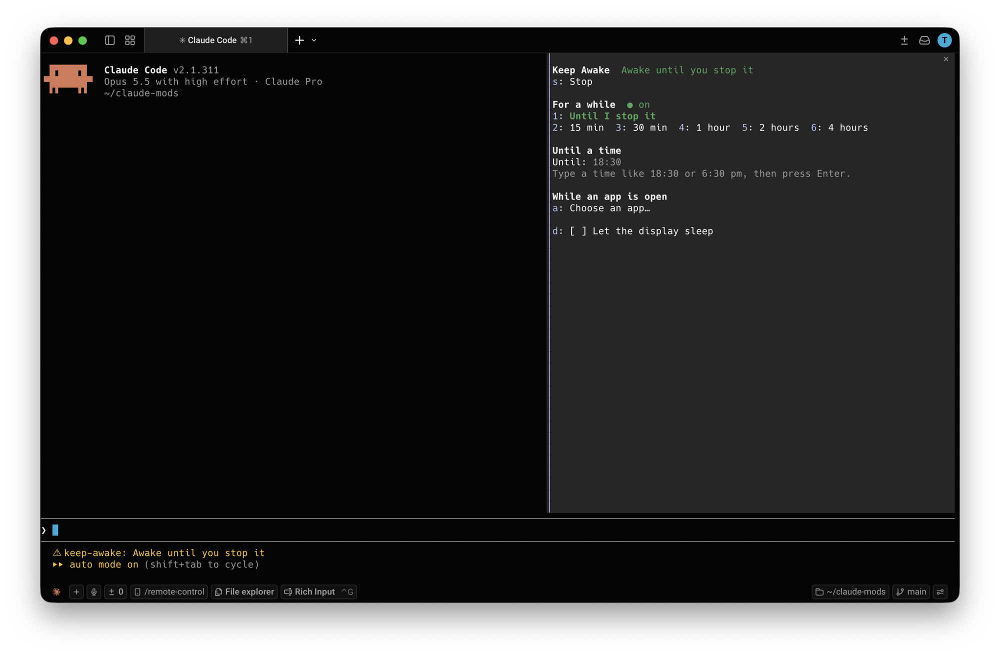

# Mac Caffeinater

A Claude Code plugin that keeps your Mac from going to sleep, without leaving Claude Code.

**`/mac-caffeinater`** opens a pane that keeps the Mac awake until you stop it, for 15 minutes to 4 hours, until a time you type, or while an app runs, with the display on or allowed to sleep. The status line under the prompt shows what's on (`Awake until 18:30`) after you close the pane.

It uses macOS's own `caffeinate`, so it needs nothing installed and no permissions.



## Do you need it?

- **While Claude works, you don't.** Claude Code already keeps the Mac awake while Claude is busy on a task: in the terminal by itself, and in the Desktop app with Settings › Claude Code › **Keep computer awake while Claude works**.
- **While Claude is idle**, for a background task or a long download, the Desktop app's Settings › System › **Keep computer awake** keeps the Mac awake whenever the app is open.
- **Mac Caffeinater is for the rest:** a set time, until a time, while an app runs, or with the display kept on, from a Claude Code session in the terminal, without the Desktop app.

## Requirements

- Claude Code v2.1.287 or later, in the terminal or the Code tab of the Claude Desktop app
- macOS. On Windows or Linux, `/mac-caffeinater` only replies that it needs macOS.

## Install

In a Claude Code terminal session:

```
/plugin install mac-caffeinater --marketplace tyastonotaufiq/claude-mods
```

Answer `y` to add the marketplace, then pick a scope. In the Desktop app: **+ › Plugins › Add marketplace** with `tyastonotaufiq/claude-mods`, then **Add plugin**.

### From a folder

Load it for one session:

```bash
claude --plugin-dir ~/claude-mods/mac-caffeinater
```

To load it in every session (and in the Desktop app), add it to `CLAUDE_CODE_PLUGIN_DIRS` in `~/.claude/settings.json`, separating several folders with `:`

```json
{
  "env": {
    "CLAUDE_CODE_PLUGIN_DIRS": "/Users/<you>/claude-mods/mac-caffeinater"
  }
}
```

## Claude Desktop

1. Install the plugin: click **+** next to the prompt box, then **Plugins › Add marketplace** with `tyastonotaufiq/claude-mods`, then **Add plugin** and pick **mac-caffeinater**. A plugin installed from a terminal at the user scope, or listed in `CLAUDE_CODE_PLUGIN_DIRS`, loads here too.
2. Open the **Code** tab and start a session. Mods only run in the Code tab, not in regular chats.
3. Type `/mac-caffeinater` in the prompt box. The pane opens beside the conversation; click its buttons or use the keys below.

## The pane

| Key | Action |
| --- | --- |
| `1` | Keep awake until you stop it |
| `2`–`6` | Keep awake for 15 min, 30 min, 1 hour, 2 hours or 4 hours |
| Until field | Type a time (`18:30`, `6:30 pm`, `6pm`) and press Enter; a time already past today means tomorrow |
| `a` | Choose an open app (one with a Dock icon); the Mac stays awake until it quits (`b` goes back, `r` refreshes the list) |
| `s` | Stop |
| `d` | Let the display sleep while the Mac stays awake (a running session goes on with it) |
| Esc | Close the pane; what you started keeps going |

The section that's running shows a green `● on` next to its heading, and a running duration is drawn bold and green. (A white box around a button is only the keyboard focus.) Starting a new session replaces the one running. The display setting is remembered across sessions.

## Known limits

- It only works while Claude Code is open: quitting Claude Code, or closing the session, ends what Mac Caffeinater started, and your Mac sleeps as usual again.
- Closing the lid still puts a MacBook to sleep unless an external display, keyboard and power are connected (macOS's closed-display mode).
- "While an app runs" follows the app's process: quitting and reopening the app ends the session.

## Files

```
mac-caffeinater/
├── .claude-plugin/plugin.json
├── hooks/
│   ├── hooks.json
│   ├── register.tsx     the pane, /mac-caffeinater, running and stopping caffeinate
│   └── awake.ts         caffeinate's arguments, running apps, typed times (no I/O)
├── docs/screenshot.png
├── types/index.d.ts
└── tests/               run with: claude plugin test .
```

Mods run with your permissions and aren't sandboxed. Read `hooks/register.tsx` and `hooks/awake.ts` before installing.
