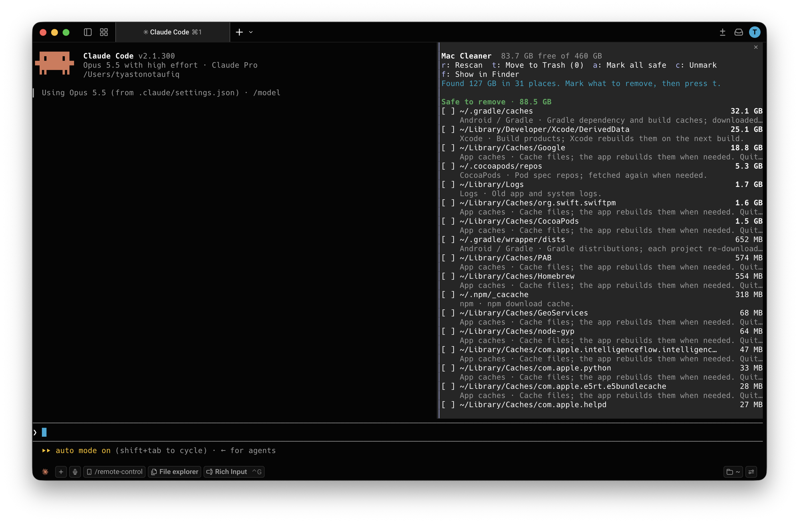

# Mac Cleaner

A Claude Code plugin that shows what's using space on your Mac and moves what you choose to the Trash, without leaving Claude Code.

- **`/mac-cleaner`** opens a pane that scans the usual space hogs (app caches, logs, Xcode, Gradle, Android emulators and system images, npm, CocoaPods), lists them by size with a reason for each, and moves what you mark to the Trash.
- **The `mac-storage` skill** lets Claude dig deeper: "why is my disk full?", "find big old files", "which old projects still have node_modules?". Claude adds what it finds to the pane, with its reasoning, and you decide there.



## Requirements

- Claude Code v2.1.287 or later, in the terminal or the Code tab of the Claude Desktop app
- macOS. On macOS 15+ it uses the built-in `trash` command; on older versions it asks Finder, so the first time macOS asks you to let your terminal control Finder.

## Install

In a Claude Code terminal session:

```
/plugin install mac-cleaner --marketplace tyastonotaufiq/claude-mods
```

Answer `y` to add the marketplace, then pick a scope. In the Desktop app: **+ › Plugins › Add marketplace** with `tyastonotaufiq/claude-mods`, then **Add plugin**.

### From a folder

Load it for one session:

```bash
claude --plugin-dir ~/claude-mods/mac-cleaner
```

To load it in every session (and in the Desktop app), add it to `~/.claude/settings.json`. With ADB Explorer too, separate the folders with `:`

```json
{
  "env": {
    "CLAUDE_CODE_PLUGIN_DIRS": "/Users/<you>/claude-mods/adb-explorer:/Users/<you>/claude-mods/mac-cleaner"
  }
}
```

## Claude Desktop

1. Install the plugin: click **+** next to the prompt box, then **Plugins › Add marketplace** with `tyastonotaufiq/claude-mods`, then **Add plugin** and pick **mac-cleaner**. A plugin installed from a terminal at the user scope, or listed in `CLAUDE_CODE_PLUGIN_DIRS`, loads here too.
2. Open the **Code** tab and start a session. Mods only run in the Code tab, not in regular chats.
3. Type `/mac-cleaner` in the prompt box. The pane opens beside the conversation; click its buttons or use the keys below.

macOS permission prompts (controlling Finder on macOS 14 and earlier, Full Disk Access) name the Claude app instead of your terminal, so grant them to Claude. Ask Claude "why is my disk full?" in the same session and its findings appear in the pane.

## The pane

Run `/mac-cleaner`. It scans fresh every time it opens, so the sizes are always current. Rows appear as each folder is measured, and the top line shows progress and the folder it's still waiting on (`Scanning 37 of 152 · found 61.2 GB so far · ~/.gradle/caches…`). With large caches the whole scan can take about a minute; you can mark rows meanwhile, and `t` works once it's done.

| Key | Action |
| --- | --- |
| Up / Down, Enter | Move between rows, mark or unmark |
| `r` | Rescan |
| `t` | Move marked items to the Trash (asks first, shows the total) |
| `a` | Mark everything under "Safe to remove" |
| `c` | Unmark everything |
| `f` | Show the first marked item in Finder |
| Esc | Close the pane |

Items are grouped into **Safe to remove** (rebuilt automatically, like caches and build output) and **Review first** (archives, emulators, files Claude found). Items under 10 MB don't get a row of their own: they're added up per category into one row, like `122 items under 10 MB in ~/Library/Caches`, which appears once the total reaches 10 MB. Marking it and pressing `t` moves each of those items to the Trash, never the folder that holds them. Claude's findings always get their own row, tagged `(Claude)`.

## Safety

- **Nothing is deleted.** Marked items go to the Trash, where Put Back works. You get the space back when you empty the Trash.
- Every move asks first, naming the item count and size.
- Only paths inside your home folder, at least two levels deep, can be trashed. iCloud Drive, Mail, Messages, the Photos library, Keychains, `~/Library/Containers` and `~/.ssh` are always refused, including anything Claude proposes.
- Every move is logged in the plugin's store (last 200).
- The skill tells Claude never to delete anything itself and to suggest tools like `brew cleanup` instead of trashing their folders.

Mods run with your permissions and aren't sandboxed. Read `hooks/register.tsx` and `hooks/cleaner.ts` before installing.

## Files

```
mac-cleaner/
├── .claude-plugin/plugin.json
├── hooks/
│   ├── hooks.json
│   ├── register.tsx     the pane, /mac-cleaner, scanning, moving to the Trash
│   └── cleaner.ts       scan targets, parsing, and the trash rules (no I/O)
├── skills/mac-storage/SKILL.md
├── docs/screenshot.png
├── types/index.d.ts
└── tests/               run with: claude plugin test .
```

## Known limits

- Some folders need Full Disk Access for an accurate size. Grant it to your terminal app in System Settings › Privacy & Security.
- Quit an app before trashing its cache, or it may recreate files right away.
- The first Gradle build after clearing `~/.gradle/caches` downloads dependencies again.
