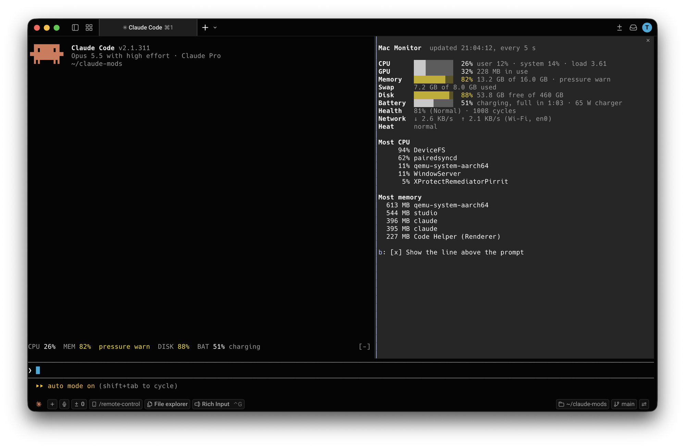

# Mac Monitor

A Claude Code plugin that shows how hard your Mac is working, without leaving Claude Code.

- **A line above the prompt**, refreshed every 5 seconds: `CPU 49%  MEM 83% pressure warn  DISK 88%  BAT 21% 1:00 left`. A value turns yellow from 75% and red from 90%; memory pressure only shows when it isn't normal, and `hot: CPU limited to 70%` appears when macOS slows the CPU for heat.
- **`/mac-monitor`** opens a pane with the details: CPU (user, system, load), GPU, memory and its pressure, swap, disk space, network speed, battery (time left, charger watts) and its health (capacity, cycle count), heat, and the five processes using the most CPU and the most memory.

Ask Claude about what you see ("what's using my memory?", "why is my Mac slow?") and it can dig in with the same commands.



## Requirements

- Claude Code v2.1.287 or later, in the terminal or the Code tab of the Claude Desktop app
- macOS. On Windows or Linux, `/mac-monitor` only replies that it needs macOS, and no line is shown.

## Install

In a Claude Code terminal session:

```
/plugin install mac-monitor --marketplace tyastonotaufiq/claude-mods
```

Answer `y` to add the marketplace, then pick a scope. In the Desktop app: **+ › Plugins › Add marketplace** with `tyastonotaufiq/claude-mods`, then **Add plugin**.

### From a folder

Load it for one session:

```bash
claude --plugin-dir ~/claude-mods/mac-monitor
```

To load it in every session (and in the Desktop app), add it to `CLAUDE_CODE_PLUGIN_DIRS` in `~/.claude/settings.json`, separating several folders with `:`

```json
{
  "env": {
    "CLAUDE_CODE_PLUGIN_DIRS": "/Users/<you>/claude-mods/mac-monitor"
  }
}
```

## Claude Desktop

1. Install the plugin: click **+** next to the prompt box, then **Plugins › Add marketplace** with `tyastonotaufiq/claude-mods`, then **Add plugin** and pick **mac-monitor**. A plugin installed from a terminal at the user scope, or listed in `CLAUDE_CODE_PLUGIN_DIRS`, loads here too.
2. Open the **Code** tab and start a session. Mods only run in the Code tab, not in regular chats. The line shows above the prompt box right away.
3. Type `/mac-monitor` in the prompt box for the pane.

## The pane

| Key | Action |
| --- | --- |
| `b` | Show or hide the line above the prompt (remembered across sessions) |
| Esc | Close the pane |

The line shares the band above the prompt with other mods: it's drawn under what they show there, and gives way to Claude Code's surveys. Hide the whole band with Claude Code's own `[-]`.

## Where the numbers come from

All from macOS's own commands, read-only, with no permissions needed:

| Value | Command |
| --- | --- |
| CPU and load | `top -l 2 -n 0 -s 1` (its second sample; the first is since boot) |
| Memory | `vm_stat` and `sysctl hw.memsize`: app memory, wired and compressed, as Activity Monitor counts it |
| Pressure, swap | `sysctl kern.memorystatus_vm_pressure_level`, `sysctl vm.swapusage` |
| Disk | `df -k ~`: the data volume your files are on |
| Battery | `pmset -g batt`; health from `system_profiler SPPowerDataType`, as System Settings shows it |
| Heat | `pmset -g therm` |
| GPU | `ioreg -c IOAccelerator`: its use and the memory it holds |
| Network | `route -n get default` for the connection in use, `netstat -ibn` for its bytes in and out, compared between samples; `networksetup -listallhardwareports` for its name (Wi-Fi) |
| Processes | `ps` |

Sampling runs `top` for about a second every 5 seconds. It stops while the line is hidden and the pane is closed. GPU, network and the process list are read only while the pane is open. Battery health is read when the pane opens and every 5 minutes, as `system_profiler` is slow.

## Known limits

- CPU and GPU temperatures and fan speed aren't shown: macOS only gives them to `sudo powermetrics`. "Heat" tells you when macOS slows the CPU because it's hot.
- Apple silicon Macs may not report a CPU speed limit, only that a heat warning was recorded; then the line reads `hot: CPU slowed`. The heat check hasn't been tried on a Mac that was actually throttling yet.
- Process CPU is `ps`'s recent average, so a burst shows up a few seconds late.
- Network speed is for the connection your traffic goes out on. Through a VPN, that's the VPN's (`utun…`), and the first reading after opening the pane says `measuring…`.

## Files

```
mac-monitor/
├── .claude-plugin/plugin.json
├── hooks/
│   ├── hooks.json
│   ├── register.tsx     the line, the pane, /mac-monitor, sampling every 5 s
│   └── monitor.ts       reading each command's output into numbers (no I/O)
├── docs/screenshot.png
├── types/index.d.ts
└── tests/               run with: claude plugin test .
```

Mods run with your permissions and aren't sandboxed. Read `hooks/register.tsx` and `hooks/monitor.ts` before installing.
