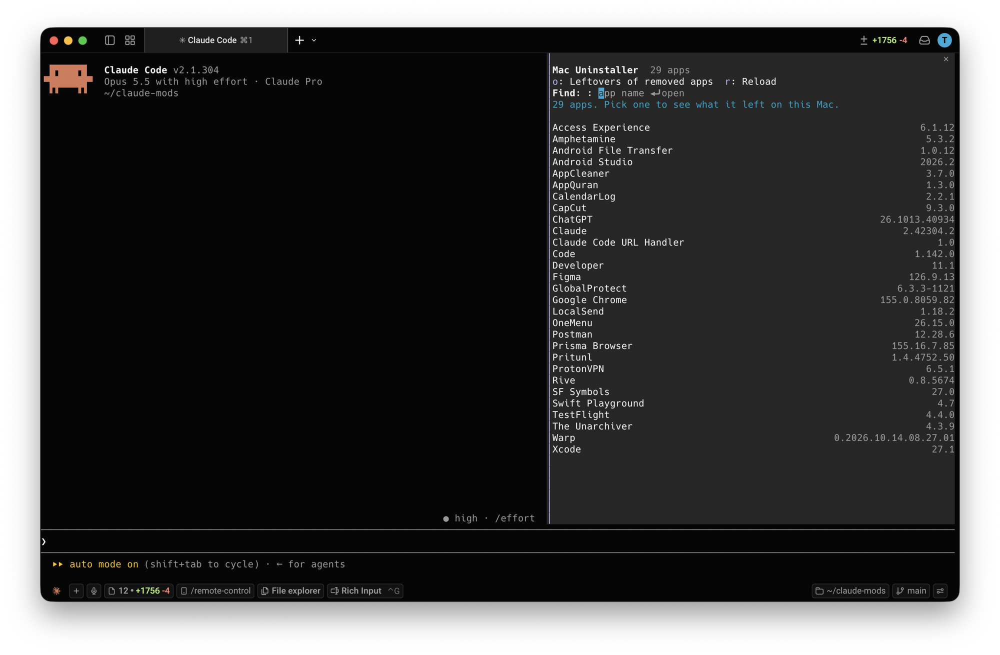

# Mac Uninstaller

A Claude Code plugin that uninstalls Mac apps completely, without leaving Claude Code. Dragging an app to the Trash leaves its caches, settings, containers and saved state behind in `~/Library`. This finds them and shows them in Finder, already selected, so you move them to the Trash along with the app yourself.

- **`/mac-uninstaller`** opens a pane listing your apps. Pick one to see the app and every file it left, with sizes, and show what you mark in Finder to move it to the Trash. `/mac-uninstaller slack` opens Slack directly.
- **Leftovers of removed apps** finds what apps you already deleted left behind, one row per app.
- **The `mac-uninstall` skill** lets Claude dig deeper: dotfolders like `~/.vscode`, CLI config, login items, files an installer put in `/Library`. Claude adds what it finds to the pane, with its reasoning, and you decide there.



## Requirements

- Claude Code v2.1.287 or later, in the terminal or the Code tab of the Claude Desktop app
- macOS

## Install

In a Claude Code terminal session:

```
/plugin install mac-uninstaller --marketplace tyastonotaufiq/claude-mods
```

Answer `y` to add the marketplace, then pick a scope. In the Desktop app: **+ › Plugins › Add marketplace** with `tyastonotaufiq/claude-mods`, then **Add plugin**.

### From a folder

Load it for one session:

```bash
claude --plugin-dir ~/claude-mods/mac-uninstaller
```

To load it in every session (and in the Desktop app), add it to `CLAUDE_CODE_PLUGIN_DIRS` in `~/.claude/settings.json`, separating folders with `:`

```json
{
  "env": {
    "CLAUDE_CODE_PLUGIN_DIRS": "/Users/<you>/claude-mods/mac-cleaner:/Users/<you>/claude-mods/mac-uninstaller"
  }
}
```

## Claude Desktop

1. Install the plugin: click **+** next to the prompt box, then **Plugins › Add marketplace** with `tyastonotaufiq/claude-mods`, then **Add plugin** and pick **mac-uninstaller**. A plugin installed from a terminal at the user scope, or listed in `CLAUDE_CODE_PLUGIN_DIRS`, loads here too.
2. Open the **Code** tab and start a session. Mods only run in the Code tab, not in regular chats.
3. Type `/mac-uninstaller` in the prompt box. The pane opens beside the conversation.

macOS permission prompts (Full Disk Access, access to other apps' data) name the Claude app instead of your terminal, so grant them to Claude.

## The pane

**All apps.** Type to filter by name or bundle ID, and press Enter to open the first match, or pick an app from the list. macOS's own apps (in `/System/Applications`, and Safari) aren't listed. Apps from Apple in `/Applications`, like Xcode, are listed.

| Key | Action |
| --- | --- |
| `o` | Leftovers of removed apps |
| `r` | Read the app list again |
| Esc | Close the pane |

**One app.** The app comes first, then each file it left, with where it is and why it's listed:

- **Marked**: the app and everything named after its bundle ID (`com.tinyspeck.slackmacgap`, its `.plist`, `.savedState`, container…).
- **Unmarked, in yellow**: folders matched by the app's name (`Application Support/Slack`), and shared group containers that other apps from the same developer may use. Check these first.
- **Unmarked**: Claude's findings, if you asked Claude to look deeper.

Unmark the app itself to keep it and only remove its leftovers, for example to reset an app to a clean state.

The pane doesn't move anything itself. Finder does, so macOS handles it as it does any move you make there: it asks for your password for an app installed by the App Store or an installer, and tells you if something is in use. After moving, press `r`: rows for what you moved disappear.

| Key | Action |
| --- | --- |
| Up / Down, Enter | Move between rows, mark or unmark |
| `r` | Look for this app's leftovers again |
| `a` / `c` | Mark all / unmark all |
| `f` | Show everything marked in Finder, selected: one window per folder. Press ⌘⌫ there to move them to the Trash, then `r` here |
| `b` | Back to all apps |

**Leftovers of removed apps.** These are files in `~/Library` named after a bundle ID that no installed app has, grouped per app so a helper like `net.whatsapp.whatsapp.intents` shares WhatsApp's row. The pane leaves out:
- Apple's own files
- IDs from a developer that still has an app installed (Google's updater while Chrome is there)
- apps Spotlight finds anywhere else on the Mac

Nothing here is marked for you: check each row, mark it (or `a` to mark all), and press `f` to show its files in Finder. `r` scans again, reading the app list afresh. Some rows belong to command-line tools rather than apps (Java, Firebase), and are usually tiny.

**System extensions.** Some apps install system extensions, which keep running after the app is gone (or while it sits in the Trash). Below the leftovers, the pane lists each extension whose app is gone, and whether it's still running or removed at the next restart. It can't remove them: use System Settings → General → Login Items & Extensions, or the app's own uninstaller. While an app's extension runs, macOS protects its containers, so Finder can't move them either: their row is yellow, and `f` says what to do first.

## Safety

- **The pane never moves or deletes anything.** It shows what you mark in Finder, and you move it to the Trash there, where Put Back works. You get the space back when you empty the Trash.
- Each path is checked again before it's shown:
  - an app must be a `.app` in `/Applications` or `~/Applications` (or one folder down, for apps installed in a folder of their own)
  - a leftover must sit directly inside one of the `~/Library` places apps write to, never the place itself
- Another app's container is never listed, even if Claude proposes it. Keychains, Mail, iCloud Drive, `~/.ssh`, `~/.aws`, shell startup files and `~/.claude` are always refused.
- System-wide files under `/Library` are never listed by the pane. Claude can list them and give you the commands to remove them.

Mods run with your permissions and aren't sandboxed. Read `hooks/register.tsx` and `hooks/uninstaller.ts` before installing.

## Files

```
mac-uninstaller/
├── .claude-plugin/plugin.json
├── hooks/
│   ├── hooks.json
│   ├── register.tsx     the pane, /mac-uninstaller, scanning, showing in Finder
│   └── uninstaller.ts   where apps leave files, matching, and what may be shown (no I/O)
├── skills/mac-uninstall/SKILL.md
├── docs/screenshot.png
├── types/index.d.ts
└── tests/               run with: claude plugin test .
```

## Known limits

- It looks in your home folder and the app folders only. Files an installer put in `/Library` (daemons, privileged helpers, system extensions) need an admin and aren't moved: ask Claude, or use the app's own uninstaller if it has one. System extensions of removed apps are listed, not removed.
- On macOS 14 and later, measuring an app's container can make macOS ask whether your terminal may access another app's data. Allow it to see the size; if you deny it, the size shows as —.
- Some folders need Full Disk Access for an accurate size. Grant it to your terminal app in System Settings › Privacy & Security.
- Leftovers that don't use the app's bundle ID or name aren't found by the pane. Ask Claude to look deeper.
