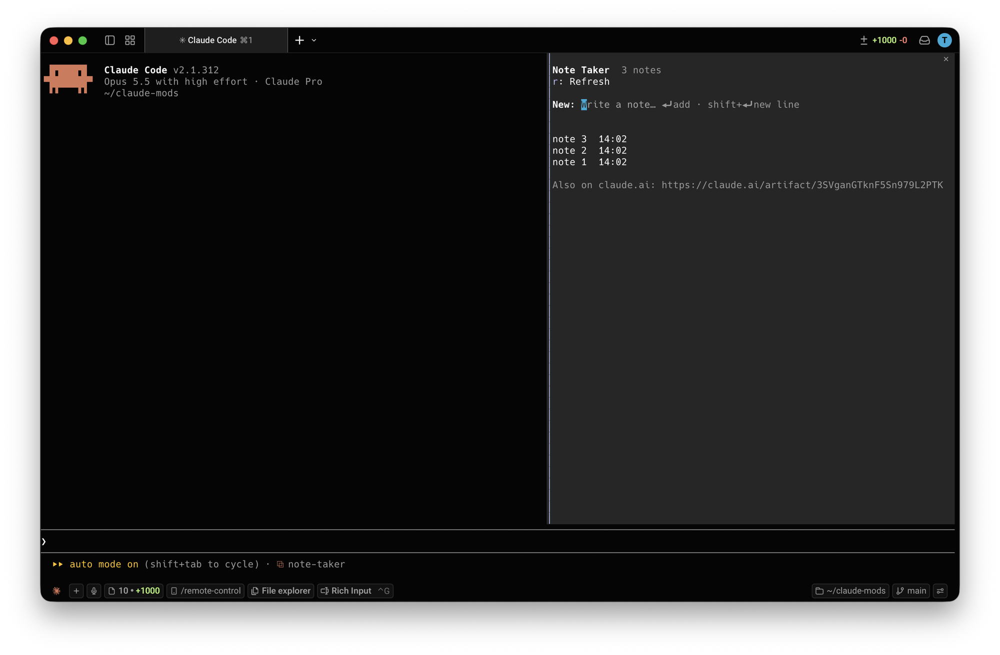

# Note Taker

A Claude Code plugin for notes you keep beside your work. **`/note-taker`** opens a pane with your notes. The same notes are on your own Note Taker page on claude.ai, so you can read and add them on any device, your phone included. You can also ask Claude to note something for you, or to find what you noted.



## How it works

- The first time you run `/note-taker`, the mod sets up your Note Taker page on claude.ai: a private page in your own account. On another computer, it finds the page you already have, so you keep one set of notes.
- Your notes are saved in that page's database, in a private area only you can read. Even if you share the page, other people see an empty notebook, not your notes.
- The first line of a note is its title.
- The page updates live. The pane reads your notes when it opens, after each change you make in it, after Claude changes them, and when you press `r`.
- The pane reads and writes notes through Claude Code's own ArtifactData tool, so Claude Code may ask your permission, like for any other tool.

## Asking Claude

The plugin comes with a skill, so you can just ask:

```
> note that the release moved to Friday
> add "adb shell pm clear com.example.app" to my notes
> what did I note about the release?
```

Claude adds or changes notes only when you ask, and asks before deleting one. An open pane shows the change right away.

## The pane

| Key | Action |
| --- | --- |
| New field | Type a note and press Enter to add it; shift+Enter starts a new line |
| A note | Open it to read, edit or delete it |
| Edit field | Change the note and press Enter to save |
| `d` | Delete the open note (`y` deletes, `n` keeps it) |
| `b` | Back to the list |
| `r` | Read your notes again, for changes made on the page |
| Esc | Close the pane |

If a note changed on the page after the pane read it, saving doesn't overwrite it: the pane shows the note as it is now, for you to edit again.

## Requirements

- Claude Code v2.1.287 or later, in the terminal or the Code tab of the Claude Desktop app, signed in with your Claude account (the page lives on claude.ai)

## Install

In a Claude Code terminal session:

```
/plugin install note-taker --marketplace tyastonotaufiq/claude-mods
```

Answer `y` to add the marketplace, then pick a scope. In the Desktop app: **+ › Plugins › Add marketplace** with `tyastonotaufiq/claude-mods`, then **Add plugin**.

To load it from a folder for one session:

```bash
claude --plugin-dir ~/claude-mods/note-taker
```

## Known limits

- The pane doesn't update live: press `r` to see a note you just added on your phone.
- Your page is a copy of `page/note-taker.html` made when it was set up. A newer version of the mod doesn't change a page you already have.
- If you delete your page, its notes are gone. The next `/note-taker` sets up a new, empty page.

## Privacy

Your notes are kept only in your Note Taker page's database on claude.ai, in your private area. On your computer, the mod remembers only your page's link.

## Files

```
note-taker/
├── .claude-plugin/plugin.json
├── docs/screenshot.png
├── hooks/
│   ├── hooks.json
│   ├── register.tsx     the pane, /note-taker, finding or setting up your page, the notebook tool for Claude
│   └── notes.ts         reading the tools' answers, titles, ids and times (no I/O)
├── page/note-taker.html the Note Taker page published to your claude.ai account
├── skills/notes/        how Claude reads and writes your notes
├── types/index.d.ts
└── tests/               run with: claude plugin test .
```

Mods run with your permissions and aren't sandboxed. Read `hooks/register.tsx` before installing.
